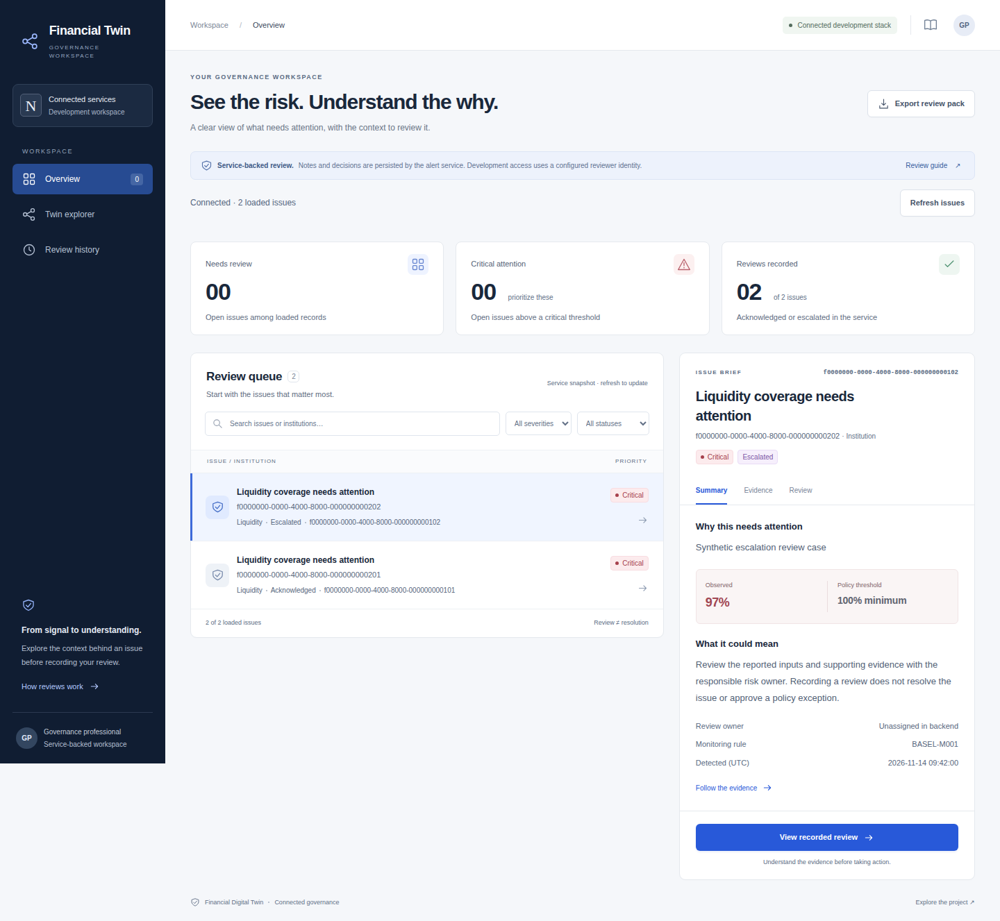
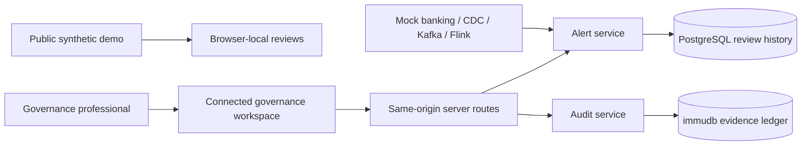

# Financial Digital Twin · Governance workspace

An open-source financial governance workspace for professionals at financial institutions. Bring monitoring issues, supporting evidence, and review decisions into one place: **understand what needs attention, follow the evidence, and record the next review action**.

**[Try the interactive demo](https://safetymp.github.io/Financial-Digital-Twin-Compliance/)** · **[Run the connected workspace](docs/governance-integration.md)** · [Documentation](docs/README.md) · [Roadmap](ROADMAP.md)

[](https://github.com/SafetyMP/Financial-Digital-Twin-Compliance/actions/workflows/governance-integration.yml)
[](https://github.com/SafetyMP/Financial-Digital-Twin-Compliance/actions/workflows/governance-pages.yml)
[](https://github.com/SafetyMP/Financial-Digital-Twin-Compliance/actions/workflows/ci.yml)
[](https://github.com/SafetyMP/Financial-Digital-Twin-Compliance/actions/workflows/codeql.yml)
[](LICENSE)



Connected development workspace with synthetic integration-test data and real alert/audit services.

## Who this is for

- **Governance, risk, and compliance professionals** exploring a clearer workflow for reviewing financial monitoring issues.
- **Financial institution engineering teams** connecting review experiences to alert, policy, and audit services.
- **Open-source contributors and coding agents** improving usability, evidence handling, and reliable integrations with reproducible checks.

The repository combines a governance application with a runnable financial digital twin reference backend. It uses synthetic banking data for development and demonstrations. It is not a production banking system, a certified compliance engine, or a regulatory filing product.

## The review workflow

1. **Find an issue.** Search and filter the review queue by severity and review status.
2. **Understand the trigger.** See the observation, threshold, monitoring rule, and available context together.
3. **Follow the evidence.** Inspect linked evidence and, in connected mode, explicitly request an audit-chain check.
4. **Record a review.** Acknowledge or escalate with a note. A review does not resolve the underlying issue or approve a policy exception.
5. **Keep the context.** Revisit review history and export a review pack. Connected reviews persist across browser reloads and service restarts.

Ease of use is the redesign's priority. The interface and workflow are implemented and tested; customer usability outcomes have not yet been measured. [Design scope and validation](docs/governance-redesign.md).

## Choose your mode

| | Public demo | Connected development workspace |
| --- | --- | --- |
| Start | [Open in a browser](https://safetymp.github.io/Financial-Digital-Twin-Compliance/) | [Setup guide](docs/governance-integration.md), port `3006` |
| Data | Six synthetic issue fixtures | Alerts from the existing backend services |
| Reviews | Saved in this browser | Stored transactionally by the alert service in PostgreSQL |
| Evidence | Illustrative evidence; no live ledger check | Linked audit entries and an explicit audit-chain verification action |
| Identity | Browser-local demonstration | Server-configured development reviewer; not end-user authentication |
| Extra exploration | Synthetic twin view and scenario sensitivity lab | Selected-alert context; no live graph query or scenario lab |

The GitHub Pages demo has no backend connection. The connected workspace never replaces a failed backend with demo fixtures. Review history is application data in PostgreSQL, separate from the immudb alert evidence ledger. [Integration boundaries](docs/governance-integration.md).

## Quick start

### Explore without installation

Open the **[GitHub Pages demo](https://safetymp.github.io/Financial-Digital-Twin-Compliance/)**. Use synthetic notes only; demo reviews remain in your browser. No account, service credentials, or financial data are needed.

### Run the demo locally

Use Node.js 22 for governance tests and builds. From the repository root:

```bash
npm ci --prefix apps/governance-console
npm run dev --prefix apps/governance-console
```

Use the local URL printed by Next.js. To test and export the static demo:

```bash
npm test --prefix apps/governance-console
NEXT_PUBLIC_BASE_PATH=/Financial-Digital-Twin-Compliance npm run build --prefix apps/governance-console
```

### Connect to the services

Follow the **[connected workspace guide](docs/governance-integration.md)** for prerequisites, service configuration, and the Compose overlay. It covers both an existing local service stack and the isolated end-to-end test stack.

For the complete mock-banking pipeline and engineering consoles, start with the [documentation index](docs/README.md), [architecture](docs/architecture.md), and [deployment guide](docs/deployment.md). Create Kafka topics **before** starting consumers, as the current [CI workflow](.github/workflows/ci.yml) does.

## Architecture



The backend retains Debezium change data capture, Kafka event contracts, per-record Apache Flink streaming, Cedar authorization (`cedar-go`), GoRules Zen decisions, and immudb audit evidence. The Flink job uses `WatermarkStrategy.forBoundedOutOfOrderness` with one minute of event-time tolerance and does not depend on `flink-cep`. Graph and simulation capabilities remain available in the engineering consoles. The reporting service is a local-name XML fixture, not an XBRL or SDMX engine.

[Component architecture](docs/architecture.md) · [Event and data contracts](docs/data-flow.md) · [Engineering capability map](docs/phase-journeys.md) · [Architecture decisions](docs/adr/)

## Verification and scope

The [governance integration workflow](.github/workflows/governance-integration.yml) exercises real Kafka, PostgreSQL, immudb, alert/audit services, the Next.js gateway, and browser review behavior using synthetic events. It checks acknowledgement, escalation, notes, restart persistence, fresh-browser history, export, retry/conflict handling, origin rejection, and backend outages.

The separate [full CI workflow](.github/workflows/ci.yml) checks the upstream pipeline, service tests, policy and Kafka contracts, console builds, Phase 1–4 smoke tests, UI proxies, and coverage gates. [Schema compatibility](.github/workflows/schema-compat.yml), [CodeQL](.github/workflows/codeql.yml), [Scorecard](.github/workflows/scorecard.yml), [image publishing](.github/workflows/docker-publish.yml), and [Pages deployment](.github/workflows/governance-pages.yml) provide additional checks.

A green workflow verifies its stated test boundary. It does not establish production security, regulatory compliance, customer usability, or performance at institutional scale. The connected workspace currently uses a configured development principal; the existing hardening overlay is not integrated end-user authentication for it. [Security posture](SECURITY.md) · [Current limitations and priorities](ROADMAP.md).

## Repository map

| Path | Purpose |
| --- | --- |
| [`apps/governance-console/`](apps/governance-console/) | Static demo and shared governance interface |
| [`apps/governance-live/`](apps/governance-live/) | Connected workspace and server-side service gateway |
| [`services/alert-service/`](services/alert-service/) | Alerts, durable reviews, notes, and idempotent review writes |
| [`services/audit-service/`](services/audit-service/) | Audit evidence, immudb ledger, and chain verification |
| [`services/`](services/) | State, policy, graph, simulation, reporting, and edge services |
| [`jobs/compliance-cep/`](jobs/compliance-cep/) | Per-record Flink streaming job |
| [`apps/`](apps/) · [`packages/console-shell/`](packages/console-shell/) | Engineering consoles and shared components |
| [`policies/`](policies/) · [`contracts/kafka/`](contracts/kafka/) · [`schemas/avro/`](schemas/avro/) | Policy bundles and event contracts |
| [`scripts/governance-e2e/`](scripts/governance-e2e/) | Reproducible connected review workflow checks |
| [`docs/`](docs/) | Current guides, architecture, and historical implementation records |
| [`AGENTS.md`](AGENTS.md) | Coding-agent entry point and scoped instructions |

## Contribute and get help

Start with [CONTRIBUTING.md](CONTRIBUTING.md), the [roadmap](ROADMAP.md), and the [documentation index](docs/README.md). Useful contributions include usability findings from governance workflows, clearer evidence states, accessible interactions, and integration regressions with reproducible tests.

- [Report a bug or propose an improvement](https://github.com/SafetyMP/Financial-Digital-Twin-Compliance/issues/new/choose)
- [Support channels and expectations](SUPPORT.md)
- [Report a security issue privately](SECURITY.md)
- [Code of Conduct](CODE_OF_CONDUCT.md)
- [Changelog](CHANGELOG.md) and [releases](https://github.com/SafetyMP/Financial-Digital-Twin-Compliance/releases)

Maintained by [SafetyMP](https://github.com/SafetyMP). Project code is licensed under [Apache License 2.0](LICENSE); bundled IBM Plex Sans fonts retain their [SIL Open Font License](packages/console-shell/assets/fonts/LICENSE.txt).
