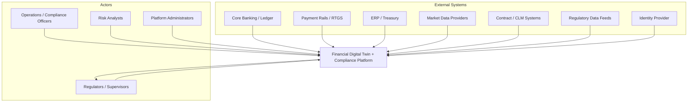
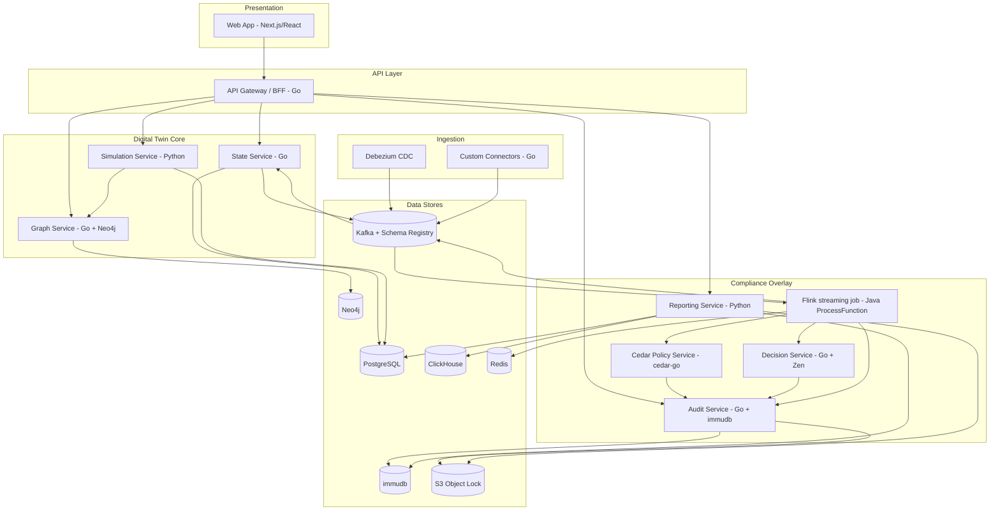
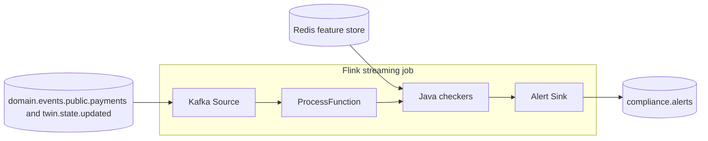
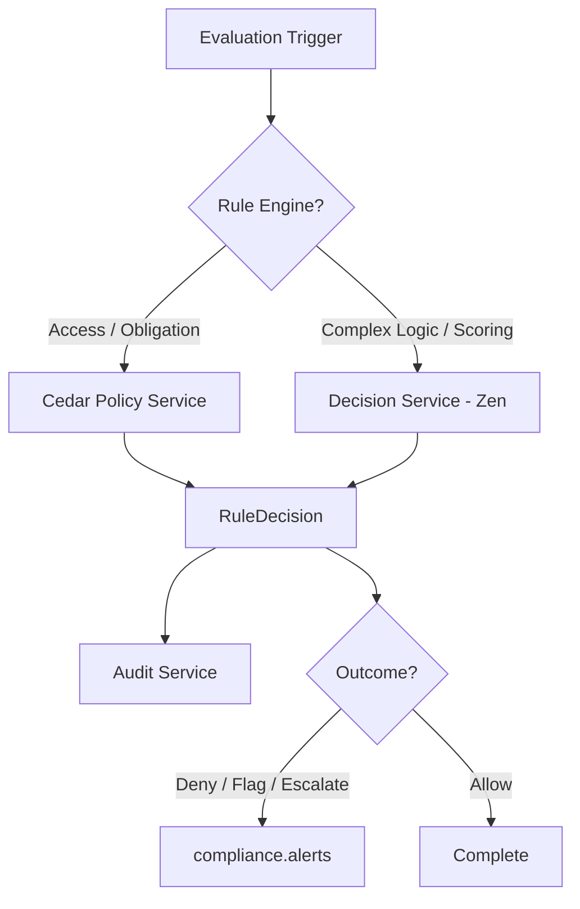
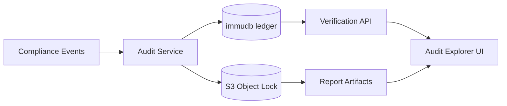

# Architecture

> **Running path.** The root [README](../README.md) is the status of record. Sections 1–5 describe the Compose path: per-record Flink streaming, `cedar-go`, and immudb `Set`/`Get`. Later sections include deployment targets that this repository does not run.

System architecture for the Financial Digital Twin + Compliance Platform. This document expands the high-level design with C4 context/container/component views and technology assignments per component.

See also: [domain-model.md](./domain-model.md), [data-flow.md](./data-flow.md), [adr/](./adr/).

---

## Implementation status

This document describes the architecture across all phases. **Public status of record:** [ROADMAP.md](../ROADMAP.md) · journey map: [phase-journeys.md](./phase-journeys.md).

| Component | Phase | Status |
|-----------|-------|--------|
| Kafka, Schema Registry, Debezium CDC | 1 | Implemented (CI smoke) |
| State Service, outbox, persona REST API | 1 | Implemented (CI smoke) |
| Per-record Flink streaming (`jobs/compliance-cep`, not `flink-cep`) | 2 | On the running path. Older CEP names in this document are design history |
| Redis online feature store | 2 | Implemented (CI smoke) |
| Alert Service, WebSocket, Alert Console, Grafana | 2 | Implemented (CI smoke) |
| Cedar Policy Service, GoRules Zen / Decision Service | 3 | Implemented (CI smoke) — [phase3-implementation-spec.md](./phase3-implementation-spec.md) |
| immudb audit ledger, Audit Explorer | 3 | Implemented (CI smoke) |
| Neo4j, Graph Service, Simulation Service, Graph Explorer, Simulation Console | 4 | Implemented (CI smoke) |
| Reporting Service, MinIO Object Lock, Report Console | 5 | Smoke-gated (local / harness) — [ADR-011](./adr/011-phase5-reporting-foundation.md) |
| Keycloak/OIDC edge, TLS nginx, OpenTelemetry | 6 | Smoke-gated overlay — [ADR-012](./adr/012-phase6-hardening-foundation.md) |
| Effectiveness / contagion→audit / reg→policy / graph analytics | 7 | Smoke-gated — [ADR-013](./adr/013-phase7-cutting-edge-foundation.md) |

---

## 1. Architectural Principles

1. **Intelligence layer, not replacement** — The twin ingests from source systems; it does not become the system of record for transactions or contracts.
2. **Event-first** — All state changes flow through a durable event log (Kafka) enabling replay, audit, and decoupling.
3. **Compliance embedded, not bolted on** — Monitoring, rules, audit, and reporting are first-class components, not afterthoughts.
4. **Polyglot best-of-breed** — Each component uses the language/runtime best suited to its concern (see [ADR-006](./adr/006-polyglot-language-strategy.md)).
5. **Policy-as-code** — Rules are version-controlled, tested in CI, and traceable to regulatory source.
6. **Explainability by design** — Every risk score and compliance decision includes rationale suitable for regulator review.
7. **Tamper-evident audit** — All compliance-relevant actions are recorded in a cryptographically verifiable ledger.

---

## 2. C4 Level 1 — System Context

### System Responsibilities

| Responsibility | Description |
|----------------|-------------|
| Ingest financial data | CDC and API connectors from operational systems |
| Maintain digital twins | Entity state, graph model, simulation |
| Monitor compliance | Per-record Flink streaming plus Java checkers for velocity, exposure, and LCR. Not the `flink-cep` library |
| Evaluate rules | Cedar (`cedar-go`) and, when configured, GoRules Zen |
| Record audit evidence | immudb `Set`/`Get` of an application hash |
| Generate reports | Local-name XML fixture in `services/reporting-service`. Not an XBRL taxonomy filing or SDMX, and not on the payment path |
| Provide dashboards | Alerts, graph viz, scenario control, audit explorer |

---

## 3. C4 Level 2 — Container Diagram

---

## 4. Layer Architecture

### 4.1 Ingestion Layer

**Purpose**: Capture domain events from source systems with schema validation and idempotent delivery.

| Component | Technology | Responsibility |
|-----------|------------|----------------|
| Debezium Connect | Java (Kafka Connect) | CDC from the Compose PostgreSQL source (`io.debezium.connector.postgresql.PostgresConnector`) |
| Schema Registry | Confluent | Present in Compose. The Flink job reads Kafka values as strings and does not use it |
| Alert envelope | JSON | `ComplianceCepJob` writes `eventId`, `eventType`, `source`, `timestamp`, `payload`, and `correlationId` as JSON |

Custom API connectors, file ingest of XBRL, and Oracle or SQL Server CDC were the original plan. This repository does not ship them.

**Design notes**:
- All events land on Kafka topics partitioned by entity ID for ordering guarantees.
- Dead-letter topics (`*.dlq`) for poison messages with alerting.
- The Flink alert sink is at-least-once. Idempotency keys dedupe alerts. Exactly-once downstream processing was the original plan.

### 4.2 Event Backbone

**Purpose**: Durable, replayable, ordered event log connecting all components.

| Component | Technology | Responsibility |
|-----------|------------|----------------|
| Apache Kafka | KRaft mode | Primary event bus; 7–10 year retention on compliance topics |
| Schema Registry | Confluent | Schema versioning and compatibility |
| Kafka Connect | Debezium, custom sinks | Bridge to PostgreSQL, ClickHouse, immudb |

See [ADR-001](./adr/001-kafka-flink-streaming.md).

### 4.3 Digital Twin Core

**Purpose**: Maintain living representations of financial entities, their interconnections, and simulation capabilities.

#### State Service (Go)

- Consumes domain events from Kafka.
- Upserts `TwinPersona`, `Account`, `Instrument`, `PaymentFlow` in PostgreSQL.
- Publishes `EntityStateUpdated` events for downstream consumers.
- Exposes REST/gRPC API for state queries.

#### Graph Service (Go + Neo4j)

- Builds and maintains exposure graph from `ExposureRecorded` events.
- Supports Cypher queries: shortest path, centrality, layer-aware aggregation.
- Publishes graph snapshot events for simulation service.

#### Simulation Service (Python)

- Agent-based and deterministic stress testing.
- Consumes graph snapshots + persona state.
- Libraries: NetworkX, pandas, PyTorch (optional ML), Ray (optional distributed).
- Outputs: risk scores, stress test results, scenario comparisons.
- Publishes `SimulationCompleted` events with explainable rationale.

### 4.4 Compliance Overlay

**Purpose**: Continuous compliance evaluation across four functions: monitoring, rules, audit, reporting.

#### Real-Time Monitoring (Apache Flink — Java)

The job in `jobs/compliance-cep` is per-record streaming. `ComplianceCepJob` uses `WatermarkStrategy.forBoundedOutOfOrderness` and `ProcessFunction`. `pom.xml` depends on `flink-streaming-java` and does not depend on `flink-cep`.

`PatternEngine` calls three Java checkers: `VelocityChecker` (INT-M001), `ExposureChecker`, and `LcrChecker` (BASEL-M001). A payment calls the velocity checker. Twin state calls LCR for an institution and exposure for an instrument. When `CEP_DECISION_SERVICE_URL` is set, those checkers call the Decision Service and fall back to the in-process threshold. Alerts are written to the `compliance.alerts` Kafka topic.

See [ADR-001](./adr/001-kafka-flink-streaming.md).

#### Policy Service (Cedar — `cedar-go`)

`services/cedar-service` is Go and depends on `github.com/cedar-policy/cedar-go`. It answers `POST /api/v1/evaluate`. It is not a Rust Cedar runtime and it does not run the Cedar Analyzer in CI.

See [ADR-002](./adr/002-cedar-decision-engine.md).

#### Decision Service (GoRules Zen — Go)

- Complex regulatory logic and risk scoring via JSON Decision Models.
- Versioned decision tables, rule chains, and scorecards.
- Business-user-friendly rule authoring with developer review in CI.
- Called by Flink jobs and Simulation Service.

See [ADR-002](./adr/002-cedar-decision-engine.md).

#### Audit Service (Go + immudb)

`services/audit-service` writes an application hash and the chain head with immudb `Set` and reads them with `Get`. It does not call `VerifiedGet`. S3 Object Lock is not part of this payment path.

See [ADR-003](./adr/003-immudb-audit-ledger.md).

#### Reporting Service (Python)

`services/reporting-service` string-builds XML. `generate_finrep_f01` uses an `xbrl` root and a `http://digitaltwin.local/...` taxonomy. AnaCredit and DORA generators use the same local namespace style. `validate.py` checks XML local names with `lxml`. This is not an XBRL taxonomy filing, not SDMX, and not on the payment path.

### 4.5 API Layer

**Purpose**: Unified query and command interface for UI and external integrations.

| Component | Technology | Responsibility |
|-----------|------------|----------------|
| API Gateway / BFF | Go | REST/GraphQL aggregation, auth middleware, rate limiting |
| WebSocket Hub | Go | Real-time alert streaming to UI |
| Auth Middleware | Cedar + OIDC | JWT validation, ABAC enforcement |

### 4.6 Presentation Layer

**Purpose**: Operator dashboards, alert management, simulation control, audit exploration.

| Component | Technology | Responsibility |
|-----------|------------|----------------|
| Web App | Next.js + React + TypeScript | SPA with SSR for dashboards |
| Graph Visualization | sigma.js / react-flow | Exposure graph, contagion paths |
| Alert Console | React components | Live alert feed, acknowledge/escalate |
| Simulation Control | React forms | Scenario parameters, run/compare |
| Audit Explorer | React + immudb client | Ledger search, hash verification |
| Report Console | Next.js | Views the local-name XML fixture. Not an XBRL viewer |

---

## 5. C4 Level 3 — Component Diagrams

### 5.1 Compliance Monitoring (Flink)

The checkers are Java classes, not Flink CEP patterns. `VEL-001`, `LIQ-001`, `SET-001`, `ICT-001`, and `EXP-001` are not rule codes in this job.

| Rule code | Checker | When it runs |
|-----------|---------|--------------|
| `INT-M001` | `VelocityChecker` | Each payment. Redis count against `velocityMaxPerHour`, or Decision Service when configured |
| `BASEL-M001` | `LcrChecker` | Twin state for an institution |
| Exposure | `ExposureChecker` | Twin state for an instrument |

### 5.2 Policy & Decision Evaluation

### 5.3 Audit & Evidence Pipeline

---

## 6. Data Store Assignments

See [ADR-004](./adr/004-datastore-selection.md) for full rationale.

| Store | Technology | Data | Retention |
|-------|------------|------|-----------|
| Entity state | PostgreSQL | Personas, accounts, instruments, contracts, rules metadata | Indefinite (soft delete) |
| Event log | Kafka | All domain and compliance events | 7–10 years (compliance topics) |
| Graph | Neo4j | Exposures, interconnections, contagion paths | Rolling snapshots + current |
| Time-series | ClickHouse | Metrics, monitoring history, aggregation inputs | 3 years hot, archive to S3 |
| Audit ledger | immudb | Decisions, alerts, state changes, access events | Regulatory minimum + 1 year |
| Cache / features | Redis | Online features, session state, rate counters | TTL-based |
| Artifacts | S3 Object Lock | Reports, evidence snapshots, Flink savepoints | 7–10 years (Compliance mode) |

---

## 7. Cross-Cutting Concerns

### 7.1 Security

| Concern | Implementation |
|---------|----------------|
| Authentication | OIDC (Auth0, Keycloak, or cloud IdP) |
| Authorization | Cedar ABAC/RBAC policies |
| Encryption at rest | AES-256 (DB, S3, Kafka) |
| Encryption in transit | TLS 1.3 everywhere |
| Secrets | HashiCorp Vault or cloud secrets manager |
| Network | Private subnets, mTLS between services |

### 7.2 Observability

| Signal | Tool | Key Metrics |
|--------|------|-------------|
| Traces | OpenTelemetry → Jaeger/Tempo | End-to-end evaluation latency |
| Metrics | Prometheus + Grafana | Kafka lag, Flink checkpoint duration, API p99 |
| Logs | Structured JSON → Loki/ELK | Correlation ID on all log lines |
| Alerts | Grafana Alerting / PagerDuty | Consumer lag > threshold, checkpoint failures |

### 7.3 Deployment

| Concern | Implementation |
|---------|----------------|
| Orchestration | Kubernetes (EKS, GKE, or self-hosted) |
| IaC | Terraform modules per environment |
| CI/CD | GitHub Actions / GitLab CI with policy test gates |
| Environments | dev → staging → prod with schema compatibility checks |
| Flink ops | Flink Kubernetes Operator |

### 7.4 Schema Governance

- All Kafka topics have registered Avro/Protobuf schemas.
- Backward-compatible schema evolution enforced by Schema Registry.
- Breaking changes require new topic version (`domain.events.v2`).
- Domain events defined in shared schema repository.

---

## 8. Non-Functional Requirements

| Requirement | Target | Component |
|-------------|--------|-----------|
| Monitoring latency | < 2s p99 from event to alert | Flink streaming job (`jobs/compliance-cep`) |
| Policy evaluation | < 5ms p99 in-process | Cedar / Zen |
| API query latency | < 200ms p99 for state reads | State Service + Redis cache |
| Audit write durability | Zero data loss (fsync + replication) | immudb |
| Event throughput | 10K events/sec sustained (initial) | Kafka |
| Availability | 99.9% for monitoring + API | K8s HA, multi-AZ |
| Report generation | < 30 min for monthly FINREP pack | Reporting Service |
| Data retention | 7–10 years compliance events | Kafka + S3 + immudb |

---

## 9. Integration Patterns

| Pattern | Use Case | Implementation |
|---------|----------|----------------|
| Event Carried State Transfer | Twin state updates | Domain events carry full entity snapshot |
| Event Sourcing (partial) | Audit trail | immudb stores all compliance events; PostgreSQL stores current state |
| CQRS | Read-heavy dashboards | ClickHouse for analytics reads; PostgreSQL for transactional writes |
| Saga | Multi-step report submission | Kafka choreography with compensating events |
| Outbox | Reliable event publishing | PostgreSQL outbox table → Debezium → Kafka |

---

## 10. Failure Modes and Mitigations

| Failure | Impact | Mitigation |
|---------|--------|------------|
| Kafka broker loss | Ingestion pause | Multi-broker replication, KRaft quorum |
| Flink checkpoint failure | Monitoring gap | Alert on checkpoint duration; auto-restart from savepoint |
| Source system unavailable | Stale twin state | `lastSyncedAt` staleness alerts; degrade gracefully |
| immudb unavailable | Audit gap (critical) | Buffer to Kafka audit topic; replay on recovery |
| Schema incompatibility | Consumer crash | Schema Registry compatibility mode = BACKWARD |
| Decision engine timeout | Missed evaluation | Circuit breaker; default to `Escalate` outcome |

---

## 11. Related Documents

- [domain-model.md](./domain-model.md) — Entities, personas, glossary
- [data-flow.md](./data-flow.md) — Topics, schemas, end-to-end flows
- [compliance-mapping.md](./compliance-mapping.md) — Regime → rule → check → report
- [roadmap.md](./roadmap.md) — Phased implementation plan
- [adr/](./adr/) — Architecture decision records
